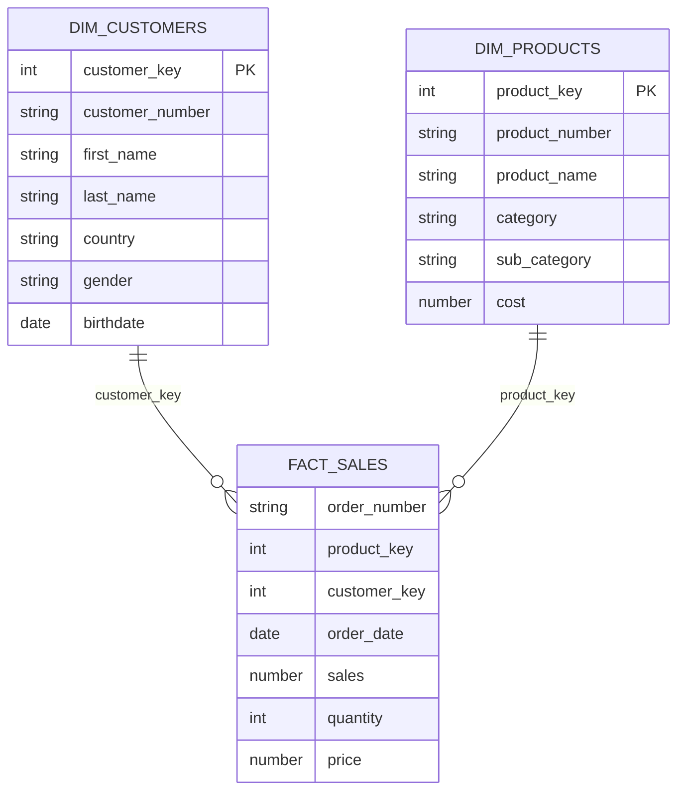
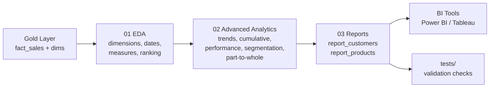

# Snowflake SQL Analytics — Customer & Product Reporting

An end-to-end **SQL analytics project in Snowflake** built on top of the Gold layer (star schema) of my
Commercial Analytics Data Warehouse. It moves from exploratory data analysis (EDA) to
advanced analytics (window functions, segmentation, part-to-whole) and finishes with two
**business-ready reporting views**: a customer report and a product report.

---

## Project Goals

- Explore the Gold-layer data model to understand dimensions, measures, and date coverage
- Answer business questions with advanced SQL: trends, running totals, YoY and vs-average comparison, segmentation, contribution %
- Package the logic into **reusable views** (`gold.report_customers`, `gold.report_products`) that BI tools (Power BI / Tableau) can consume directly
- Validate every output with row-count, uniqueness, and reconciliation checks

---

## Data Model (Gold Layer)



**Grain of `fact_sales`:** one row per order line (order_number + product).

---

## Analytics Workflow



---

## Repository Structure

```
snowflake-sql-analytics/
├── README.md
├── docs/
│   ├── report_definitions.md        # KPI definitions & segmentation rules
│   └── sql_patterns.md              # Window functions, CTE patterns, Snowflake vs SQL Server notes
├── scripts/
│   ├── 01_eda/
│   │   ├── 01_database_exploration.sql
│   │   ├── 02_dimensions_exploration.sql
│   │   ├── 03_date_exploration.sql
│   │   ├── 04_measures_exploration.sql
│   │   ├── 05_magnitude_analysis.sql
│   │   └── 06_ranking_analysis.sql
│   ├── 02_advanced_analytics/
│   │   ├── 07_change_over_time.sql
│   │   ├── 08_cumulative_analysis.sql
│   │   ├── 09_performance_analysis.sql
│   │   ├── 10_data_segmentation.sql
│   │   └── 11_part_to_whole.sql
│   └── 03_reports/
│       ├── 12_report_customers.sql
│       └── 13_report_products.sql
└── tests/
    └── validation_checks.sql
```

---

## Reports

### 1. Customer Report — `gold.report_customers`

One row per customer, combining profile, behaviour, and KPIs.

| Group | Fields |
| --- | --- |
| Profile | customer_key, customer_number, customer_name, age, age_group |
| Segment | customer_segment (VIP / Regular / New) |
| Aggregates | total_orders, total_sales, total_quantity, total_products, lifespan (months) |
| KPIs | recency (months since last order), avg_order_value, avg_monthly_spend |

### 2. Product Report — `gold.report_products`

One row per product, combining attributes, performance, and KPIs.

| Group | Fields |
| --- | --- |
| Attributes | product_key, product_name, category, sub_category |
| Segment | product_segment (Low / Mid / High Performance) |
| Aggregates | total_orders, total_sales, total_quantity, total_customers, lifespan (months) |
| KPIs | recency, avg_order_revenue, avg_monthly_orders, avg_monthly_sales |

Full KPI formulas and segmentation thresholds: `docs/report_definitions.md`

---

## SQL Techniques Used

| Technique | Where |
| --- | --- |
| Multi-step CTEs (base → aggregation → KPIs) | Both reports |
| `SUM() OVER (ORDER BY …)` running totals | `08_cumulative_analysis.sql` |
| `AVG() OVER (ORDER BY … ROWS BETWEEN …)` moving average | `08_cumulative_analysis.sql` |
| `LAG()` for year-over-year comparison | `09_performance_analysis.sql` |
| `AVG() OVER (PARTITION BY …)` vs-average comparison | `09_performance_analysis.sql` |
| `SUM() OVER ()` for % of total | `11_part_to_whole.sql` |
| `CASE` segmentation | `10_data_segmentation.sql`, reports |
| `RANK()` / `DENSE_RANK()` top-N | `06_ranking_analysis.sql` |
| `DATEDIFF`, `DATE_TRUNC` | Trends, lifespan, recency |
| Division-by-zero guards | Report KPIs |

---

## How to Run

**Prerequisites:** Snowflake account with the Gold layer loaded (`gold.fact_sales`, `gold.dim_customers`, `gold.dim_products`).

```sql
USE WAREHOUSE <your_warehouse>;
USE DATABASE  <your_database>;
```

1. Run the scripts in `scripts/01_eda` and `scripts/02_advanced_analytics` in order (they are read-only `SELECT` queries).
2. Run `scripts/03_reports/12_report_customers.sql` and `13_report_products.sql` to create the views.
3. Run `tests/validation_checks.sql` — every check should return the expected result noted in the comments.
4. Query the views:

```sql
SELECT * FROM gold.report_customers ORDER BY total_sales DESC LIMIT 10;
SELECT * FROM gold.report_products  ORDER BY total_sales DESC LIMIT 10;
```

Snowflake CLI option:

```bash
snow sql -f scripts/03_reports/12_report_customers.sql
snow sql -f scripts/03_reports/13_report_products.sql
snow sql -f tests/validation_checks.sql
```

---

## Validation

Each report is checked for:

- **Grain:** one row per customer / product (no duplicates)
- **Completeness:** row count equals distinct keys in `fact_sales`
- **Reconciliation:** `SUM(total_sales)` in each report equals `SUM(sales)` in `fact_sales`
- **Safety:** no NULL or negative KPIs, no division-by-zero

---

## Business Questions Answered

- How are sales trending month over month and year over year?
- What is the cumulative revenue over time?
- Which products perform above or below their own average, and vs. last year?
- Which categories contribute the most to total revenue?
- How many customers are VIP, Regular, or New?
- Which products are high, mid, or low performers?
- What is the average order value and monthly spend per customer?

---

## Related Project

This project consumes the Gold layer of my **Snowflake Commercial Analytics Data Warehouse**
(Bronze → Silver → Gold, Medallion architecture).

---

## Tools

Snowflake · SQL · Snowflake CLI · Git/GitHub · VS Code

## Author

**Mohamed Al Razek**
